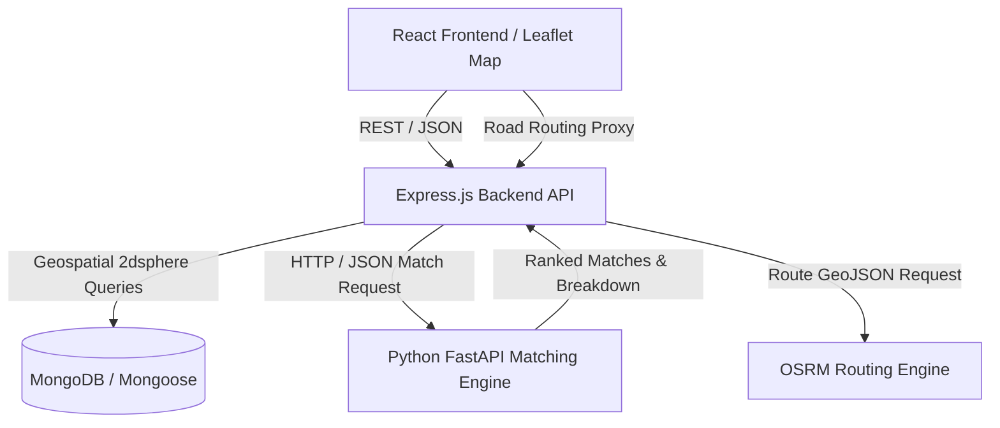

# FoodBridge AI — System Architecture & Design Specification

## 1. High-Level System Architecture

FoodBridge AI is built as a resilient, modular full-stack application connecting commercial food providers with verified recipient organizations through intelligent geospatial routing and explainable recipient matching.



---

## 2. Explainable Rule-Based Matching Algorithm

The matching service evaluates surplus food against verified community organizations in two distinct stages.

### Stage 1: Mandatory Eligibility Filters (Hard Constraints)
Food safety and legal eligibility are non-negotiable gates:
1. **Verification Gate:** The recipient organization must have `isVerified === true`. Unverified NGOs are rejected from automatic matching.
2. **Food Safety Gate:** The provider's attestation (`isSafeForConsumption`, `preparedUnderHygieneStandards`, `temperatureMaintained`) must all evaluate to `true`.
3. **Temporal Feasibility:** The collection deadline must not have passed (`collectionDeadline > now`).
4. **Capacity Headroom:** The organization's available capacity (`maxCapacity - currentCapacityUsed`) must be greater than or equal to the donation's quantity.
5. **Geographic Proximity Feasibility:** The distance between the pickup location and recipient must not exceed the recipient's operating service area radius (`distanceKm <= serviceAreaKm`).
6. **Dietary & Storage Compatibility:** Non-vegetarian items are excluded from strictly vegetarian kitchens; temperature-sensitive items require compatible refrigeration or hot-holding facilities.

### Stage 2: Weighted Multi-Criteria Scoring (Normalized 0–100)
For each eligible candidate, four normalized factors are computed:

$$\text{matchScore} = (0.40 \times \text{proximityScore}) + (0.25 \times \text{compatibilityScore}) + (0.20 \times \text{capacityScore}) + (0.15 \times \text{availabilityScore})$$

- **Proximity Score (40%):** $\max\left(0, \left(1 - \frac{\text{distance}}{\text{serviceRadius}}\right) \times 100\right)$
- **Compatibility Score (25%):** Alignment of dietary classifications and required storage facilities.
- **Capacity Score (20%):** Percentage of recipient headroom available relative to maximum intake capacity.
- **Availability Score (15%):** Operating hours and immediate receipt availability.

Matches are sorted descending by `matchScore`. If the top recipient declines, the platform executes an **automatic cascade fallback** to the second-ranked recipient in the queue.

---

## 3. Concurrency Protection & Atomic Acceptance

To prevent race conditions where multiple organizations attempt to accept the same surplus donation simultaneously:

```javascript
const updatedDonation = await Donation.findOneAndUpdate(
  {
    _id: donationId,
    status: { $in: ['available', 'matching'] },
    collectionDeadline: { $gt: new Date() }
  },
  {
    $set: {
      status: 'accepted',
      acceptedBy: recipientOrg._id
    }
  },
  { new: true }
);
```

If another request acquired the listing milliseconds earlier or the deadline expired, `updatedDonation` returns `null`, and the endpoint immediately responds with `409 Conflict`, preserving data integrity.

---

## 4. Cryptographic Handover Verification

To guarantee that donated food is only received by the designated organization and avoid false collection claims:

1. **Code Generation:** When an acceptance is confirmed, the system generates a cryptographically random 6-digit verification code using `crypto.randomBytes()`.
2. **Hashed Persistence:** Only the **SHA-256 hash** of the code is stored in the database alongside an expiration timestamp. The raw code is never exposed in public donation records.
3. **Presentation & Verification:** The authorized recipient displays their 6-digit PIN (or QR code). The provider or volunteer inputs the PIN into the verification modal.
4. **Anti-Replay Protection:** Once verified, `isVerified` is set to `true`, timestamps and verifier IDs are locked, and repeated attempts with the same PIN are blocked.
